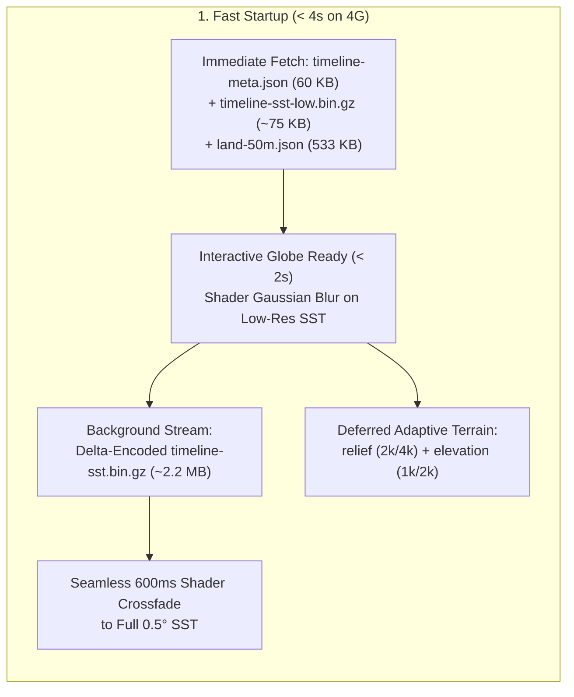

# Performance & Startup Optimization Plan (`#50`)

## Goal Description

Address [kmd-labs/el-nino#50](https://github.com/kmd-labs/el-nino/issues/50) and the follow-up comments to achieve:
1. **Interactive globe in < 4 seconds on 4G mobile** and **Lighthouse Performance (mobile) ≥ 70** with "good" Core Web Vitals (LCP, TBT, INP, CLS).
2. **Smooth 120 FPS rendering on midrange devices** by eliminating redundant CPU/GPU work per animation frame, optimizing WebGL draw calls and buffer uploads, and skipping work when the playhead/camera are idle or the view/tab is hidden.

---

## Root-Cause Audit of Current Bottlenecks

### A. Initial Download & Main-Thread Startup Bottlenecks (~10.5 MB on critical path)
1. **8.0 MB Blocking Download (`timeline-sst.bin.gz`)**:
   - [`SplashHostComponent`](src/app/components/splash/splash-host.component.ts) blocks the experience until [`CurrentWeatherService`](src/app/core/services/current-weather.service.ts) finishes downloading and decompressing the entire 8.0 MB `timeline-sst.bin.gz` (105 frames at 0.5° resolution = 27.3 MB uncompressed).
   - Furthermore, `this.weather.load()` is not called until `SplashHostComponent.onRevealed()` fires (after the splash logo animation), adding hundreds of milliseconds of idle network delay before the fetch even starts.
   - **Why `timeline-sst.bin.gz` is 8.0 MB**: Each 0.5° frame is 259,200 bytes. Standard `gzip` uses a 32 KB sliding window, so it cannot reach across frames (`259 KB > 32 KB`) to exploit temporal similarity between consecutive weeks.
2. **Simultaneous Unprioritized Terrain Downloads (`relief.bin.gz` 1.7 MB + `elevation.png` 321 KB)**:
   - `GlobeComponent.initLandOverlay()` fires `loadRelief()` (1.7 MB gzipped / 8.4 MB raw) and `loadElevation()` (321 KB) immediately at startup, competing for 4G bandwidth with `timeline-meta.json`, `land-50m.json`, and SST data.
   - `reliefLayer()` loops over `4096 × 2048 = 8,388,608` pixels in JavaScript on the main thread (`33.5 MB` `ImageData`), causing a ~200–350 ms main-thread task (hurting Lighthouse TBT).
3. **Dead Startup Computation in `GlobeComponent.initSstData()`**:
   - `initSstData()` allocates four `Float32Array(259200)` arrays (`CLIM`, `BP`, `BC`, `BN` = 4.1 MB) and runs 259,200 iterations of `clim()`, `basisP()`, `basisC()`, `basisN()` (~6.5 million `Math.exp`/`Math.pow` calls) synchronously in `ngAfterViewInit()`. **None of `CLIM`, `BP`, `BC`, or `BN` are ever read anywhere in the codebase.**
4. **Synchronous 120-Step Warm-Up Freeze in `CurrentWeatherLayer`**:
   - When `weather.status() === 'ready'`, `CurrentWeatherLayer.update()` runs `120` synchronous steps of `updateWind()` and `updateWaves()`. Because both functions rebuild the entire `wPos`/`wCol`/`vPos`/`vCol` vertex buffers on every step, startup executes **82.4 million vertex writes** in a single frame (~300–600 ms freeze right as the splash screen fades).
5. **1,048,576-Triangle Land Sphere Geometry**:
   - `initLandOverlay()` creates `new THREE.SphereGeometry(R * 1.003, 1024, 512)` on desktop (`524,288` vertices / `1,048,576` triangles) and `512 × 256` on mobile (`262,144` triangles), which is expensive both to construct on the CPU during startup and for the vertex shader to displace every frame.
6. **Unused 1.8 MB Asset in Repository**:
   - `src/assets/data/current-weather.json` (1.8 MB) is no longer referenced anywhere in `src/` or `scripts/`.

---

### B. Per-Frame CPU & WebGL Bottlenecks (Blocking 120 FPS)
1. **Hidden Analytic Wind & Waves Computed Every Frame**:
   - In `GlobeComponent.animate()`, `updateAtm()` calls `updateWind()` (1,700 particles, 45,900 line segments, 3,400 `windAt()` calls) and `updateWaves()` (750 particles) **every single frame even after `weatherReady` is `true` and `ensoWindLines.visible` / `ensoWaveLines.visible` are `false`**.
2. **19.2 MB/Frame Vertex Uploads & 686,800 `Math.pow()` Calls in `CurrentWeatherLayer`**:
   - `CurrentWeatherLayer` uses `NW = 450, TRAIL = 260` (`116,550` segments) and `NV = 650, V_TRAIL = 350` (`226,850` segments) = **343,400 line segments (`686,800` vertices = 19.2 MB of `Float32Array` data uploaded to the GPU every frame, or 2.3 GB/s at 120 FPS)**.
   - Inside the inner loops (`current-weather.layer.ts` lines 249–250 and 314–315), `(1 - sIdx / (T - 1)) ** 0.75` is recomputed **686,800 times per frame** instead of reading a precomputed `Float32Array(TRAIL)` lookup table.
   - At 120 FPS, pushing one trail point per frame halves the physical length of trails compared to 60 FPS and packs ~10 redundant vertices per screen pixel.
3. **CPU Texture Recoloring (`recolorTexture`) on Every Playback/Scrub Frame**:
   - `recolorTexture()` loops over all `259,200` pixels on the CPU, interpolates between `indexA` and `indexB`, maps through `lutSst`, and uploads `1.04 MB` of RGBA bytes to the GPU on every frame while playing or scrubbing.
   - Moving keyframe interpolation (`mix(texA, texB, uMix)`) and LUT color mapping into the **globe fragment shader** reduces per-frame CPU work to **zero** (only uploading a 259 KB single-channel slice when `indexA` or `indexB` changes, ~2×/sec).
4. **285 Separate Draw Calls for Bokeh & Cloud Puffs**:
   - `initBokeh()` creates **200 individual `THREE.Sprite` meshes** (200 draw calls).
   - `initAtmosphere()` creates **~85 individual `THREE.Mesh` cloud puffs** (85 draw calls) and recomputes their `Matrix4` basis + quaternion on the CPU every frame even when `s` is unchanged.
5. **Unconditional `sCur.set()` Signal Mutation & DOM Label Thrashing When Idle**:
   - `EnsoStateService.updateInterpolatedStrength()` calls `this.sCur.set(next)` on **every animation frame** even when paused and `sCur === sTarget`, dirtying downstream Angular `computed()` signals (`MapDockComponent.dateMarkers` runs `new Intl.DateTimeFormat` 4× per frame).
   - `GlobeComponent.layoutLabels()` projects 3D coordinates, sorts, runs collision detection, and writes `.style.opacity` and `.style.transform` on 17 DOM nodes every frame even when neither the camera nor `s` has moved.

---

## Proposed Changes



---

### 1. Data Pipeline & Progressive Asset Compression (`scripts/`)

#### [MODIFY] `scripts/fetch-current-weather.mjs`
- **Temporal Delta-Encoding for Full-Res `timeline-sst.bin.gz`**:
  - Add a compact 8-byte header (`'KMDS'`, version `2`, `nLat`, `nLon`, `totalFrames`) or `encoding: 'delta-u8'` in `timeline-meta.json`.
  - Store frame `0` raw, and frames `1..N-1` as byte-wise temporal deltas `(frame[f][i] - frame[f-1][i]) & 0xff`. Because weekly SST changes by 0 or ±0.2°C at >90% of ocean pixels, `gzip -9` compresses the full 105-frame 0.5° dataset from **8.0 MB down to ~2.0–2.4 MB** lossless.
- **Generate Low-Res Preview Binary (`src/assets/data/timeline-sst-low.bin.gz`)**:
  - Downsample the 105 SST frames by `4×` (`0.5° → 2.0°`, `180 × 90 = 16,200` bytes/frame) + the `10°` `airGrid`, delta-encoded and gzipped.
  - Total size for **all 105 weekly frames + airGrid** at 2° resolution is **~65–85 KB gzipped** (100× smaller than 8.0 MB!).
  - Emit `lowBinFile: 'assets/data/timeline-sst-low.bin.gz'` and `lowGrid: { step: 2.0, nLat: 90, nLon: 180, lat0: -89.0, lon0: -179.0 }` in `timeline-meta.json`.

#### [MODIFY] `scripts/fetch-relief.mjs` & `scripts/fetch-elevation.mjs`
- Generate compact mobile/low-bandwidth variants alongside the desktop files:
  - `src/assets/data/relief-2k.bin.gz` (`2048 × 1024`, ~380 KB gzipped vs 1.7 MB for 4k).
  - `src/assets/data/elevation-1k.png` (`1024 × 512`, ~85 KB vs 321 KB for 2k).

#### [DELETE] `src/assets/data/current-weather.json`
- Remove unused 1.8 MB legacy JSON file.

---

### 2. Progressive Weather Streaming & Seamless Upgrade (`src/app/core/services/`)

#### [MODIFY] `src/app/core/services/current-weather.service.ts`
- **Two-Stage Loading State**:
  - Start `load()` immediately when the app initializes (`AppComponent.constructor`), not waiting for the splash animation's `onRevealed()`.
  - **Stage 1 (Critical Path, ~130 KB total)**: Fetch `timeline-meta.json` and `timeline-sst-low.bin.gz` in parallel. Decode the 2° `sstLowBin` (`180 × 90`) and `airBin`, set `status.set('ready')`, and unblock the splash screen immediately!
  - **Stage 2 (Background Upgrade)**: Immediately begin streaming the full 0.5° `timeline-sst.bin.gz` in the background without blocking user interaction. When ready, decode delta frames into `sstBin` (`720 × 360`) and set `highResReady = signal(true)`.
  - Ensure `samplePointAt()` and `nino34Sst()` seamlessly read from `sstBin` when `highResReady()` is true, or fall back to `sstLowBin` (`lowGrid`) during the first few seconds.

#### [MODIFY] `src/app/components/splash/splash-host.component.ts` & `src/index.html`
- Reduce artificial splash delays (`MIN_VISIBLE_MS` from `2200` to `750`, `REVEAL_HOLD_MS` from `500` to `150`, `FADE_MS` from `620` to `380`) so fast/4G connections reach interactive state in **< 2.5–3.5 seconds**.
- Add `<link rel="preload" href="assets/data/timeline-meta.json" as="fetch" crossorigin>` and `<link rel="preload" href="assets/data/land-50m.json" as="fetch" crossorigin>` in `src/index.html`.

#### [MODIFY] `src/app/core/services/enso-state.service.ts`
- In `updateInterpolatedStrength(dt)`: if `!this.isPlaying()` and `Math.abs(target - cur) < 1e-4`, snap `this.sCur.set(target)` once and return early instead of calling `this.sCur.set(next)` on every frame forever.

---

### 3. Globe WebGL & Per-Frame Performance (`src/app/components/globe/`)

#### [MODIFY] `src/app/components/globe/globe.component.ts`
1. **Remove Dead Startup Arrays**:
   - Delete `CLIM`, `BP`, `BC`, `BN` allocations and the 259,200-pixel transcendental math loop in `initSstData()`.
2. **GPU Shader SST Interpolation, LUT Color Mapping & Low→High-Res Crossfade**:
   - Instead of CPU-side `recolorTexture()` looping over 259,200 pixels every frame:
     - Upload a `256 × 1` `DataTexture` for `math.lutSst`.
     - Maintain two single-channel (`THREE.RedFormat`, `Uint8Array`) keyframe textures (`sstTexA`, `sstTexB`) for the active resolution, plus low-res (`180 × 90`) textures during the initial seconds.
     - Only upload a new 1-byte-per-pixel frame slice when `pair.indexA` or `pair.indexB` changes!
     - In the custom fragment shader on `globeMat`:
       - Sample `texA` and `texB` (with a wider 9-tap Gaussian kernel when sampling the initial 2° low-res grid, and crisp 5-tap smoothing on the 0.5° high-res grid).
       - Blend low-res and high-res textures over `0.6s` (`uUpgradeMix` uniform `0 → 1`) when `weather.highResReady()` becomes true — zero pop or visual discontinuity!
       - Map the interpolated temperature byte through the 1D LUT texture and apply the `impacts` dim factor via uniform `uDim`.
3. **Adaptive DEM & Deferred Relief**:
   - Defer `loadRelief()` and `loadElevation()` until after `state.experienceReady()` (so they download after the splash screen is ready).
   - Detect device/network tier (`isLowTierDevice()`: mobile breakpoint, `navigator.connection?.saveData`, `effectiveType` in `['slow-2g', '2g', '3g']`, or `hardwareConcurrency <= 4`):
     - On low-tier/mobile devices: load `relief-2k.bin.gz` (~380 KB) instead of 4k (1.7 MB), load `elevation-1k.png` (~85 KB) or disable `displacementMap` on weak GPUs, and reduce `landSeg` from `512` to `256` (`256 × 128 = 65k` triangles).
     - On desktop/midrange devices: reduce `landSeg` from `1024` (`1,048,576` triangles) to `384` (`384 × 192 = 147,456` triangles — **7× fewer vertices** with identical visual relief quality).
4. **Stop Updating Hidden Analytic Wind/Waves & Batch Draw Calls**:
   - In `updateAtm()`: skip `this.updateWind()` and `this.updateWaves()` whenever `this.weather.status() === 'ready'`.
   - Convert the 200 bokeh `THREE.Sprite` meshes in `initBokeh()` into a single `THREE.InstancedMesh` (or `THREE.Points`), cutting **200 draw calls down to 1**.
   - Convert the ~85 cloud puff `THREE.Mesh` objects in `initAtmosphere()` into 3 `THREE.InstancedMesh` objects (`matBase`, `matMid`, `matTop`), cutting **85 draw calls down to 3**.
5. **Idle Frame Skipping, Dirty-Checking & Tab Visibility Throttling**:
   - Pause/resume the `requestAnimationFrame` loop on `document.visibilitychange` (`document.hidden`).
   - Track `cameraMoved` (distance/angle delta of `camera.position` / `camera.quaternion`) and `strengthChanged` (`Math.abs(s - lastFrameS) > 1e-4`).
   - Only run `updateLabels(s)`, `layoutLabels()`, and `updateInspectTooltip()` when `cameraMoved || strengthChanged || inspectDirty`.
   - Cache label sizes via a single `ResizeObserver` / language-change effect instead of reading `el.offsetWidth` / `el.offsetHeight` inside the render loop every 30 frames.

#### [MODIFY] `src/app/components/globe/current-weather.layer.ts`
- **Fast Position-Only Warm-Up**:
  - Split particle advection (`stepWindPositions`, `stepWavePositions`) from vertex buffer emission (`buildWindVertices`, `buildWaveVertices`). During the 120-step initial seed warm-up, only advance particle positions and history rings, then build the GPU vertex buffers **once** after the loop finishes.
- **Precomputed Trail Decay LUTs & Fixed-Step Ring Buffers**:
  - Precompute `wDecay = new Float32Array(TRAIL)` (`(1 - sIdx / (TRAIL - 1)) ** 0.75`) and `vDecay = new Float32Array(V_TRAIL)` (`(1 - sIdx / (V_TRAIL - 1)) ** 0.70`) once in the constructor, eliminating **686,800 `Math.pow()` calls per frame**.
  - Use a ring buffer head index `histHead` (or fixed arc-step sub-sampling with `TRAIL = 72`, `V_TRAIL = 96` and tuned step speed) so trails have consistent physical length at both 60 FPS and 120 FPS while reducing per-frame vertex buffer writes and WebGL buffer uploads by **~4×**.
  - Scale particle counts for mobile vs desktop (`NW = 300, NV = 420` on mobile; `NW = 450, NV = 650` on desktop).

---

### 4. UI & Secondary Views Optimization

#### [MODIFY] `src/app/components/map-dock/map-dock.component.ts`
- Remove unused `activeSst` (which loops over the Niño 3.4 grid on every `sCur` signal change) and `daily` computed signals.
- Optimize `dateMarkers` and `activeDateLabel` so `Intl.DateTimeFormat` only formats when the date string (`YYYY-MM-DD`) or language actually changes, not 120 times per second during playback.

#### [MODIFY] `src/app/components/walker-view/walker-view.component.ts`
- Pause `requestAnimationFrame` when `document.hidden` or `page.about()` is active.
- Cache the sky `CanvasGradient` on resize instead of calling `createLinearGradient` every frame.

---

## Verification Plan

### Automated Tests & Build Verification
1. Run the data scripts or verify binary generation and unit tests:
   ```bash
   npm test
   npm run build
   ```
2. Update and add unit tests in:
   - `src/app/core/services/current-weather.service.spec.ts` (testing delta decoding, progressive low-res to high-res fallback, and `samplePointAt`).
   - `src/app/core/services/enso-state.service.spec.ts` (testing idle `sCur` convergence without redundant signal emissions).

### Performance & Manual Verification
1. **Network & Startup Verification**:
   - Inspect Network waterfall in DevTools (throttled to Fast 4G / Slow 4G): verify that `timeline-meta.json` (~60 KB) + `timeline-sst-low.bin.gz` (~75 KB) + `land-50m.json` unblock the globe in < 3s, followed by background streaming of `timeline-sst.bin.gz` (~2.2 MB) and deferred `relief` / `elevation`.
   - Verify the visual transition from low-res blurred SST to full-res 0.5° SST is completely imperceptible (smooth 600ms shader crossfade).
2. **Frame Timing & 120 FPS Verification**:
   - Profile `GlobeComponent.animate()` in Chrome DevTools Performance tab: verify per-frame JS time is **< 2.5 ms** during playback/orbiting (well within the 8.33 ms budget for 120 FPS) and **< 0.3 ms** when camera and playhead are idle.
   - Verify all views (`Globe`, `Walker`, `Impacts`, `Cycles`), point temperature inspection, pins, and languages (`EN`, `PL`, `ES`) work identically.
